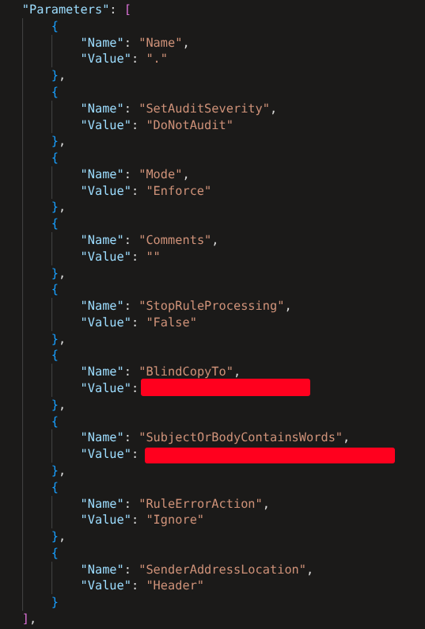

# Converting an array with multiple JSON to a single JSON

While working with Unified Audit Logs (this can be found in other Microsoft product logs as well) I came accross the image multiple times and it is extremely annoying to work with this format.




Because I suspect many of you have the same issue here are some KQL snippets you can use for managing these annoying log fields. 

It is important for the `| summarize Params=make_set(Params), arg_max(TimeGenerated,*) by id` to summarize a unique value by a unique value to preperly create a new set with the parameters. For my case this was a unique log id, if used outside the context of UAL you might want to find another unique value.


### UAL - Parameters and any other similar field
```
| extend Parameters=AuditData.Parameters
| mv-apply Parameters=Parameters on (
    summarize Parameters=make_bag(bag_pack(tostring(Parameters.Name),tostring(Parameters.Value)))
)
```
